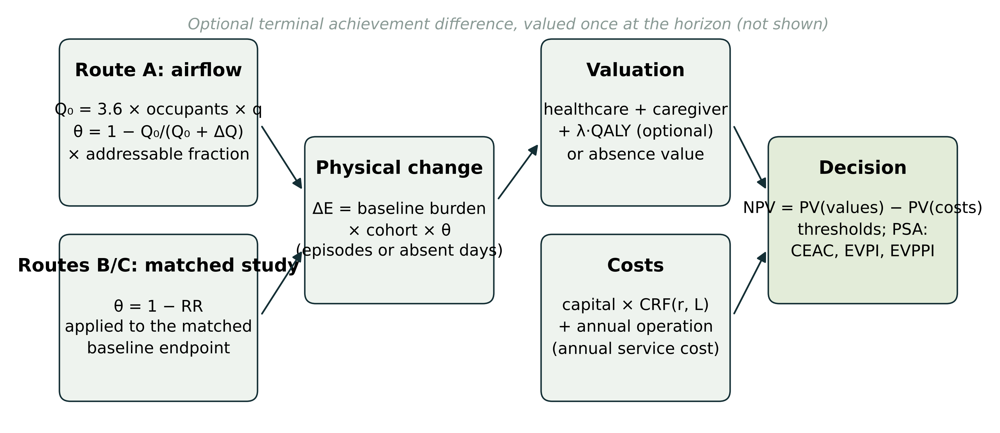
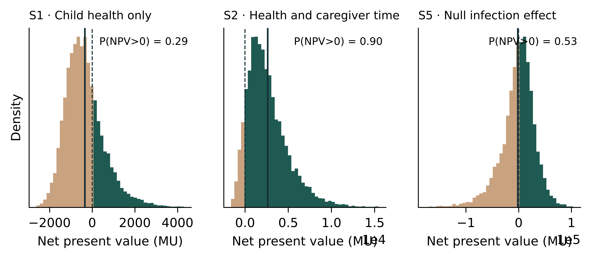
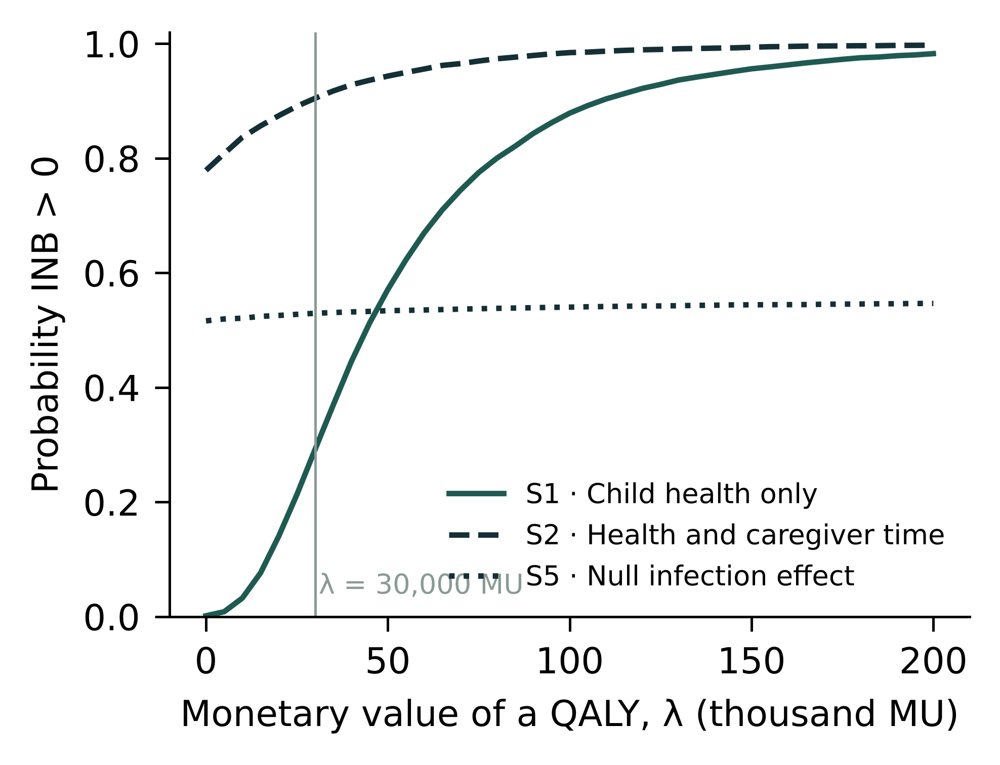
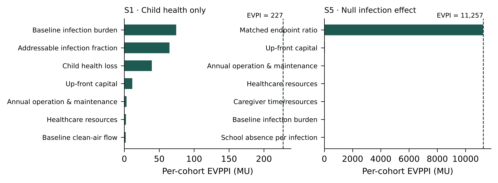
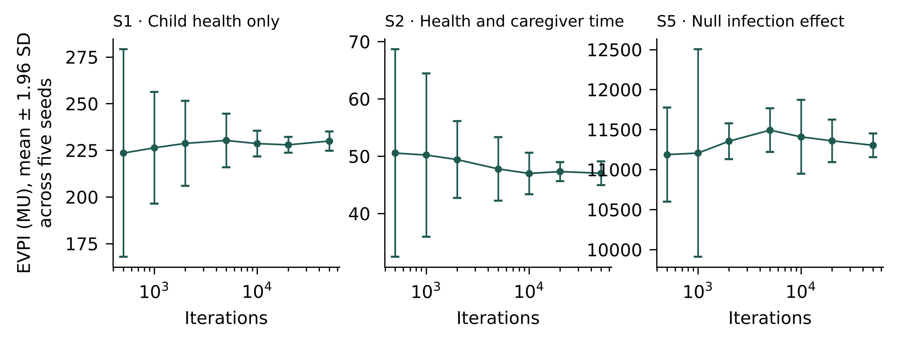

**Running title:** Value of information for school clean air

**Target journal:** *Applied Health Economics and Health Policy* (Original Research Article). The structured abstract, Key Points for Decision Makers and Declarations follow that journal's instructions for authors.

**Corresponding author:** Austin Henderson, University of Otago, Dunedin, New Zealand. Email: [to be completed].

**Word count:** main text approximately 4,600 words, excluding the abstract, tables, figure legends and references. 3 tables; 4 figures; 1 supplementary figure.

---

# Abstract

**Background.** Schools can reduce exposure to airborne infection and particulate matter with portable filtration or improved ventilation. Evidence on the outcomes that carry economic value is, however, sparse, heterogeneous and frequently null. These outcomes include infection episodes, absence, health-related quality of life and achievement. Deterministic break-even analysis shows what an intervention would need to achieve, but not how likely it is to achieve it or what further evidence would be worth.

**Objective.** To extend a transparent cost–benefit framework for classroom clean-air interventions (CASCADE) with probabilistic sensitivity analysis and value-of-information methods, and to show what these add to decisions made under the current evidence base.

**Methods.** The framework compares a specified intervention with no added intervention for a stable cohort of pupils. It has three mutually exclusive outcome routes: a steady-state airflow route, a matched infection episode-rate ratio and a matched absence ratio. Annualised service costs and valued outcomes are discounted to a common date. We propagated parameter uncertainty by Monte Carlo simulation (10,000 iterations), using beta, gamma and lognormal distributions centred on the deterministic inputs. We estimated acceptability curves over the monetary value of a quality-adjusted life-year (QALY), the per-cohort expected value of perfect information (EVPI), and single-parameter expected value of partial perfect information (EVPPI) by nonparametric spline regression. Three hypothetical demonstrations, reported in synthetic monetary units (MU), varied the valuation scope and the effect evidence.

**Results.** All three demonstrations had the same present cost of 1,916 MU. When only child-health outcomes were valued (S1), the probability of positive net benefit was 0.29 and the EVPI was 227 MU per cohort. The baseline infection burden and the addressable infection fraction accounted for the largest partial values. Adding caregiver time (S2) raised the probability to 0.91 and reduced the EVPI to 47 MU. A null matched effect with moderate uncertainty (S5) gave a probability of 0.47 and an EVPI of 9,450 MU per cohort, almost all attributable to the effect ratio. In S5, a 1.8% reduction in infection episodes would break even. A simple binning estimator overstated the EVPPI of weakly informative parameters by up to three orders of magnitude.

**Conclusions.** Under the illustrative assumptions, the value of further research on school clean air lies almost entirely in endpoint-specific effect estimates and the share of infection burden that is addressable, rather than in cost data. A trial that cannot exclude small effects on infection episodes may be worth more than its point estimate suggests.

---

# Key Points for Decision Makers

- A deterministic "below break-even" result can coexist with a substantial probability that a school clean-air intervention is worthwhile, and with a high value of further research.
- In the demonstrations, uncertainty about the effect on infection episodes, and about the share of infections that classroom air actually addresses, dominates the value of information. Uncertainty about equipment and running costs contributes little.
- A null trial result is not the same as a known zero effect. When the economic break-even effect is small, an imprecise null leaves the adoption decision close to a coin toss.
- The probabilistic extension runs in a web browser with seeded, reproducible simulations and downloadable draws. All results are conditional on explicit, editable distributions.

---

# 1 Introduction

Classroom air quality affects exposure to airborne infection, particulate matter and carbon dioxide (CO₂). Many classrooms fall below ventilation guidelines [@fisk2017ventilation], and portable high-efficiency particulate air (HEPA) filtration reliably reduces particle concentrations [@simona2025classroom; @banholzer2024air]. The outcomes that justify spending on clean air, however, are distinct from the exposure change and from one another. They include infection episodes, illness-related absence, asthma symptoms, health-related quality of life and academic achievement.

Evidence on these outcomes is limited and mixed:

- **Infection and absence.** A Swiss crossover study reported fewer respiratory-infection absences with air cleaners, but its modelled infection relative risk had a credible interval that included 1 [@banholzer2024air]. A large observational study associated higher ventilation with lower illness absence [@mendell2013absence]. A retrospective Italian cohort reported lower SARS-CoV-2 cluster risk in mechanically ventilated classrooms [@buonanno2022marche].
- **Asthma.** A factorial randomised trial of classroom HEPA purifiers in children with asthma found no significant effect on symptom-days [@phipatanakul2021sicas2].
- **Learning.** A regression-discontinuity study found test-score gains after filter installation [@gilraine2025filters]. A large randomised trial found no acute effect of cleaner air on adolescents' attention [@gignac2021atenco]. Exposure–response syntheses of CO₂ and task performance exist [@wargocki2020relationships], but they do not identify a durable, transferable gain that could be valued through earnings [@chetty2011star; @watts2020achievement].

Economic evaluations of school air interventions are correspondingly rare. One societal-perspective cost-effectiveness analysis of the SICAS-2 interventions reported a favourable incremental cost-effectiveness ratio, but over a short horizon and alongside a null primary trial result [@samnaliev2025cea].

CASCADE is a transparent, browser-based cost–benefit framework for this setting [@henderson2026cascade]. It deliberately avoids automatic conversions that the evidence does not support, such as CO₂ to learning, attendance to earnings, or onward-transmission multipliers. It reports *break-even thresholds*: the effect on a matched endpoint, or the terminal achievement difference, that would be needed for valued outcomes to equal costs. Thresholds answer "what would need to be true?" but leave two questions open for decision-makers:

1. Given current uncertainty, how likely is the intervention to be worthwhile?
2. Is it worth waiting for, or funding, better evidence before deciding?

Probabilistic sensitivity analysis (PSA) and value-of-information (VOI) analysis are the standard tools for these questions in health economic evaluation [@claxton1999irrelevance; @briggs2006decision; @briggs2012uncertainty; @wilson2015voi]. This paper extends CASCADE with a PSA and VOI module that runs entirely in the browser and applies it to three hypothetical demonstrations. Our contributions are:

- an open, tested implementation of PSA, acceptability curves, EVPI and regression-based EVPPI for a school clean-air decision;
- a demonstration that, under illustrative assumptions, research value is concentrated in effect evidence rather than cost data;
- a methodological observation: when a single parameter dominates net-benefit variance, a common binning estimator of EVPPI can overstate the value of the remaining parameters by orders of magnitude.

The analysis is methodological. It does not estimate the return to any real intervention.

# 2 Methods

Reporting follows the Consolidated Health Economic Evaluation Reporting Standards 2022 (CHEERS 2022) [@husereau2022cheers] where items apply to a methodological demonstration; the checklist is provided as Supplementary Table S1. Modelling practice follows the ISPOR–SMDM guidance on parameter uncertainty and model transparency [@briggs2012uncertainty; @eddy2012transparency].

## 2.1 Decision problem and perspective

The decision is whether to adopt a specified classroom clean-air intervention, such as portable HEPA filtration, for one stable cohort of pupils, compared with no added intervention. The cohort is followed over a stated horizon (five years in the demonstrations). No new cohort enters, and annual burdens are held constant.

The perspective is chosen by the analyst through the valuation scope. It ranges from child-health outcomes only to the inclusion of caregiver time. Costs and valued outcomes occur at year end and are discounted at a common annual rate (3% in the demonstrations). All values are in synthetic monetary units (MU), so that the demonstrations are not read as estimates for any jurisdiction.

## 2.2 Model structure

Figure 1 summarises the model. The physical effect enters through one of three mutually exclusive routes. Using a single route prevents double counting and stops effects on one endpoint being imported into another.

**Route A (airflow scenario).** Baseline effective clean-air supply is $Q_0 = 3.6 \times N_\text{occ} \times q$ m³/h, where $N_\text{occ}$ is the number of room occupants and $q$ is the effective flow in L/s/person. Adding delivered clean air $\Delta Q$ reduces steady-state, well-mixed exposure by

$$\theta = 1 - \frac{Q_0}{Q_0 + \Delta Q}.$$

This is the low-dose limit of the Wells–Riley model [@riley1978measles]; an exponential dose–response form is also available. The reduction applies only to the *addressable* fraction $a$ of baseline episodes. This is an explicit, uncalibrated assumption representing infections acquired through the room-air pathway that the intervention changes.

**Route B (matched infection effect).** An endpoint-compatible episode-rate ratio $RR$ gives $\theta = 1 - RR$, applied directly to all baseline episodes.

**Route C (matched absence effect).** A ratio of expected absent days is applied to baseline absence days, with no conversion to infections or QALYs.

With $n$ pupils and baseline burden $b$ (episodes or days per pupil per year), the annual physical change is $\Delta E = n\,b\,\theta$. On Route A the right-hand side is multiplied by $a$.

**Valuation.** On Routes A and B, each averted episode is valued at

$$v = p_\text{med}\,c_\text{med} + c_\text{care} + \mathbb{1}_\text{health}\,\lambda\,\ell,$$

where:

- $p_\text{med}$ is the probability that an episode is medically attended and $c_\text{med}$ its healthcare resource cost;
- $c_\text{care}$ is caregiver time per episode;
- $\ell$ is the QALY loss per episode and $\lambda$ the monetary value of a QALY;
- $\mathbb{1}_\text{health}$ indicates whether health is monetised.

On Route C, each averted day carries a non-overlapping resource value.

**Learning.** An optional terminal achievement difference is valued once, at the horizon. It is excluded in all demonstrations.

**Costs.** Capital is converted to an equivalent annual service cost using the capital-recovery factor $\text{CRF}(r,L) = r/[1-(1+r)^{-L}]$ and added to annual operating cost.

**Net benefit.** The incremental net present value is

$$\text{NPV} = \sum_{t=1}^{T}\frac{\Delta E\,v - C}{(1+r)^t},$$

where $C$ is the annual service cost and $T$ the horizon. The comparator, no added intervention, has an NPV of zero by definition.

## 2.3 Demonstrations

The three demonstrations reproduce those in the CASCADE framework manuscript and website. They share a cohort of 25 pupils and one adult, a five-year horizon and asset life, 3% discounting, capital of 1,000 MU and operating cost of 200 MU per year (Table 1).

- **S1 (child health only)** uses Route A with:
  - baseline effective flow of 4 L/s/person;
  - added flow of 505.44 m³/h, which corresponds to 5.4 L/s/person for 26 occupants;
  - four episodes per pupil per year, of which 7.5% are addressable;
  - an expected healthcare cost of 20 MU per episode;
  - 0.002 QALYs per episode, valued at 30,000 MU/QALY.
- **S2** adds caregiver time of 150 MU per episode.
- **S5** replaces Route A with an invented null episode-rate ratio ($RR = 1$) under the S2 valuation.

No study is claimed to supply these inputs. Because the horizon equals the asset life, the annualised costing gives the same present cost as paying capital up front.

## 2.4 Characterising uncertainty

Every uncertain input in the active route received a distribution centred on its deterministic value (Table 1). Distribution families follow standard conventions [@briggs2006decision; @briggs2012uncertainty]:

- **beta** for proportions (the addressable fraction and the probability of medical attendance);
- **gamma** for costs and positive burdens (capital, operating cost, healthcare and caregiver costs, baseline episodes, absence per episode, QALY loss and added flow);
- **lognormal** for the baseline flow;
- **normal** for the optional terminal achievement difference.

The matched endpoint ratio is lognormal and *median-centred*: $\ln RR \sim N(\ln \widehat{RR}, \sigma^2)$. This corresponds to sampling from the usual log-scale estimate of a ratio, and it ensures that a null point estimate remains neutral. A mean-centred lognormal with mean 1 has median $e^{-\sigma^2/2} < 1$, which tilts a null ratio towards benefit (Section 3.4).

Because no evidence-based dispersion exists for most inputs, we applied three generic uncertainty envelopes with coefficients of variation (CV) of 10%, 30% (base case) and 60%. For the ratio, $\sigma = \sqrt{\ln(1+\text{CV}^2)}$.

A parameter whose central value sits on the boundary of its support was held fixed. Examples are a 100% "probability" that encodes an expected cost per episode and a zero caregiver cost in S1.

Decision and valuation parameters were not sampled, because they are analyst choices rather than quantities to be estimated. These are the cohort size, horizon, discount rate, $\lambda$ and the value per standard deviation of achievement. Instead, $\lambda$ is varied in the acceptability analysis.

Draws were truncated at the calculator's input limits; truncation affected 5 draws in one high-envelope run (S5) and none in the base case. As a scenario representing trial evidence, we also analysed S5 with $\ln RR \sim N(0, 0.182^2)$. This corresponds to a hypothetical null trial with a 95% confidence interval of 0.70–1.43.

## 2.5 Probabilistic analysis and value of information

Each analysis used 10,000 Monte Carlo iterations with a fixed seed (20261104). Uniform deviates came from the mulberry32 generator, normal deviates from the Box–Muller transform and gamma deviates from the Marsaglia–Tsang method [@marsaglia2000gamma]; beta deviates were formed as ratios of gamma deviates. Every iteration ran the unmodified deterministic model, so the probabilistic and deterministic results share one code path.

We report:

- the mean NPV, with its Monte Carlo standard error (MCSE);
- the 2.5th and 97.5th percentiles, labelled a "95% simulation interval" to distinguish them from confidence intervals;
- the probability that NPV > 0.

**Acceptability curve.** The acceptability curve plots $\Pr\{\text{INB}(\lambda) > 0\}$ against $\lambda$ [@fenwick2001ceac], where

$$\text{INB}(\lambda) = \text{NPV} - H + \lambda\,\text{QALY}_\text{PV}.$$

Here $H$ is the scenario's own monetised health value and $\text{QALY}_\text{PV}$ the discounted QALY gain. This substitution makes the curve defined whether or not the scenario monetises health. Route C has no QALYs and therefore no curve.

**EVPI.** For the adopt/do-not-adopt decision against a zero comparator, the per-cohort expected value of perfect information is [@claxton1999irrelevance]

$$\text{EVPI} = E[\max(\text{INB},0)] - \max(E[\text{INB}],0).$$

**EVPPI.** Single-parameter EVPPI was estimated by nonparametric regression [@strong2014regression]. INB draws were regressed on a natural cubic regression spline of the standardised parameter, with six knots at quantiles, giving fitted values $\hat g$. Then

$$\text{EVPPI} \approx \overline{\max(\hat g, 0)} - \max(\bar{\hat g}, 0).$$

Estimates were truncated to the interval [0, EVPI]. For comparison, we also computed the binning estimator of Sadatsafavi et al. [@sadatsafavi2013speed], which uses ⌊√n⌋ equal-count bins.

**Population EVPI.** Population EVPI multiplies the per-cohort EVPI by the number of cohorts facing the same decision each year and by the annuity factor over the period in which the information would remain useful [@wilson2015voi]. We illustrate this for 100 to 100,000 cohorts per year over ten years at 3%.

## 2.6 Implementation and verification

The model and the PSA module are plain JavaScript modules (`model.mjs`, `psa.mjs`) with no dependencies. They run in the browser and in Node.js. An automated test suite of 32 tests checks the following:

- **Deterministic model:** parity with the manuscript demonstrations; the reciprocity of the capital-recovery and annuity factors; and the threshold identities (NPV is zero at each reported threshold).
- **Distribution sampling:** the first two moments of each family (within 2–3% at 60,000 draws).
- **EVPI:** agreement with its closed form when INB is normal.
- **EVPPI:** recovery of the full EVPI for a sole driver, near-zero values for noise parameters, correct capture of a non-monotone relationship, and the regression estimator's resistance to the bias of the binning estimator.
- **Edge cases:** exact reproduction of the deterministic result at zero uncertainty.

The JavaScript spline EVPPI was independently reimplemented in Python (NumPy). The two implementations agreed to within 0.1 MU for every parameter reported. Convergence was assessed by repeating analyses with five seeds at 500 to 50,000 iterations (Supplementary Figure S1). Analysis scripts, figure code and the complete set of draws are provided with the source code.

# 3 Results

## 3.1 Deterministic results

All demonstrations have a present cost of 1,916 MU (Table 2).

- **S1.** Route A averts 4.31 episodes a year, because a 57.4% reduction in addressed exposure risk applies to 7.5 addressable episodes. Valued outcomes are 1,579 MU and the NPV is −337 MU. Break-even would require a 69.7% reduction in addressed risk.
- **S2.** Adding caregiver time raises valued outcomes to 4,538 MU and the NPV to +2,622 MU. The break-even reduction falls to 24.3%.
- **S5.** The null ratio gives an NPV of −1,916 MU. Because Route B applies the ratio to all 100 baseline episodes a year, an episode-rate ratio of 0.982 or lower (a 1.8% reduction) would break even.

## 3.2 Probabilistic results

Figure 2 shows the NPV distributions, and Table 2 reports the base-case summaries.

- **S1.** Mean NPV was −350 MU (MCSE 9; 95% simulation interval −1,830 to 1,923), with $\Pr(\text{NPV}>0) = 0.29$.
- **S2.** Mean NPV was 2,613 MU (interval −725 to 8,663), with $\Pr(\text{NPV}>0) = 0.91$.
- **S5.** Mean NPV was −6,511 MU, but the interval was very wide (−90,437 to 51,457) and $\Pr(\text{NPV}>0) = 0.47$. The mean lies below the deterministic value because $E[1-RR] = 1 - e^{\sigma^2/2} < 0$ under a median-centred ratio. The probability nonetheless stays close to one half.

The ranking of the scenarios by probability matched the ranking by deterministic NPV for S1 and S2 but not for S5. The S5 intervention had the lowest deterministic NPV, yet a substantially higher probability of being worthwhile than S1.

The width of the envelope mattered (Table 3). For S2, $\Pr(\text{NPV}>0)$ was 1.00, 0.91 and 0.63 under the low, moderate and high envelopes. For S1, it was 0.14, 0.29 and 0.29. As dispersion grew, the right-skewed gamma and beta distributions moved probability mass towards larger benefits, offsetting the wider spread.

**Acceptability.** S1 became more likely than not to be worthwhile at a monetary value of health between 40,000 and 45,000 MU/QALY (Figure 3). The probability was 0.29 at the scenario value of 30,000 MU/QALY and 0.98 at 200,000 MU/QALY. S2 had a probability of 0.78 even at λ = 0, because caregiver time alone often covered costs. The S5 curve was nearly flat (0.46–0.48): with a null ratio, the QALY value scales gains and losses symmetrically.

## 3.3 Value of information

The base-case per-cohort EVPI was 227 MU for S1, 47 MU for S2 and 9,450 MU for S5 (Table 2). For S5, EVPI was nearly five times the intervention's present cost.

Partial values were highly concentrated (Figure 4):

- **S1.** The baseline infection burden (EVPPI 74 MU) and the addressable fraction (65 MU) dominated, followed by the QALY loss per episode (39 MU). Capital (12 MU) and operating costs (3 MU) contributed little.
- **S2.** Every single-parameter EVPPI was below 2 MU.
- **S5.** The endpoint ratio alone carried an EVPPI of 9,425 MU, 99.7% of EVPI. No other parameter exceeded 2 MU.

Under the hypothetical trial-based distribution for S5 (95% CI 0.70–1.43), $\Pr(\text{NPV}>0)$ was 0.45 and EVPI was 5,958 MU per cohort.

Population EVPI scales linearly with the number of cohorts facing the decision. Over ten years at 3% (annuity factor 8.53), 1,000 cohorts a year would give a population EVPI of 1.9 million MU for S1 and 80.6 million MU for S5. These values are upper bounds on the expected value of research that would resolve all the represented uncertainty. They are not estimates of the value of any particular study.

## 3.4 Methodological checks

**EVPI convergence.** EVPI estimates converged by about 10,000 iterations (Supplementary Figure S1). The between-seed standard deviation of EVPI at 10,000 iterations was 3.5 MU for S1 (1.5% of EVPI), 1.8 MU for S2 and 212 MU for S5 (2.2%).

**Binning estimator bias.** The binning EVPPI estimator agreed with the regression estimator for influential parameters. For S1, the baseline burden scored 75.8 MU by binning and 74.3 MU by regression; for the S5 endpoint ratio, the values were 9,444 and 9,425 MU. Binning badly overstated weak parameters when one parameter dominated the variance. In S5, operating cost scored 28.0 MU by binning against 1.5 MU by regression, capital 29.6 MU against 0.8 MU, and baseline burden 10.7 MU against 0.0 MU. Under the earlier mean-centred parameterisation, the overstatement exceeded 600 MU for several cost parameters, more than the intervention's annual cost.

The bias arises because Monte Carlo noise in the bin means is convexified by the $\max(\cdot,0)$ operator. Its size therefore scales with the residual variance contributed by *other* parameters. The regression estimator, which smooths across the whole sample, was unaffected.

**Ratio parameterisation.** A mean-centred lognormal for the null ratio in S5 gave $\Pr(\text{NPV}>0) = 0.53$ and an EVPI of 11,257 MU. This was more optimistic than the median-centred result (0.47 and 9,450 MU), solely because of the parameterisation.

# 4 Discussion

## 4.1 Principal findings

Adding probabilistic and VOI analysis to a deliberately conservative cost–benefit framework changes the questions that the demonstrations can answer. Three findings stand out.

**First, the value of information sits in effect evidence.** Across scenarios, uncertainty about intervention cost contributed little. When the airflow route was used, the decision-relevant uncertainty lay in the baseline infection burden and the addressable fraction. When a matched study effect was used, it lay in the effect ratio itself. This pattern is consistent with the evidence base: exposure reductions are well documented [@simona2025classroom; @banholzer2024air], whereas effects on valued endpoints are imprecise or null [@phipatanakul2021sicas2; @gignac2021atenco]. It suggests that research on school clean air should prioritise endpoint-specific effect estimates, ideally episode-rate ratios with adequate precision, together with evidence on the share of children's infections acquired through classroom air. Further costing studies would add little.

**Second, an imprecise null is not a known zero.** In S5, the deterministic result is clearly negative, yet the intervention has close to even odds of being worthwhile and a very high EVPI. The economic break-even effect is small (a 1.8% reduction in episodes) relative to plausible uncertainty in the ratio. In such settings, a trial that is "negative" on statistical significance may still leave the decision substantially uncertain. This is the "irrelevance of inference" argument [@claxton1999irrelevance] applied to school air. In the hypothetical null trial, with a 95% CI of 0.70–1.43, the probability of positive net benefit was 0.45. The analysis also shows why the framework applies a matched ratio to all baseline episodes only when the ratio is endpoint-compatible: Route B carries considerably more leverage than Route A, where only the addressable fraction is affected.

**Third, the valuation scope moves probability as well as point estimates.** S1 and S2 differ only in whether caregiver time is valued. This choice moves the probability of a worthwhile investment from 0.29 to 0.91 and reduces the EVPI five-fold. Perspective is a normative choice, and the probabilistic results make its consequences explicit rather than resolving it.

## 4.2 Methodological observations

Two technical points may be useful beyond this application.

First, the popular binning estimator of single-parameter EVPPI [@sadatsafavi2013speed] can overstate the value of parameters that explain little variance whenever another parameter dominates. In our S5 example, the overstatement exceeded the intervention's annual cost. The regression approach of Strong et al. [@strong2014regression] avoided the problem at negligible computational cost: a full analysis takes under half a second in a browser at 20,000 iterations. We recommend regression-based estimators, or at minimum a comparison of binned estimates against a regression estimate, for any parameter whose binned EVPPI is small relative to EVPI.

Second, how a ratio distribution is centred matters near the null. Matching a lognormal's *mean* to a point estimate of 1 places more than half of the probability mass below 1. In S5, this inflated both $\Pr(\text{NPV}>0)$ and EVPI. Centring on the median, which corresponds to sampling $\ln RR$ around its estimate, is the coherent choice when the input is a published ratio estimated on the log scale [@briggs2006decision].

## 4.3 Relation to other work

The closest economic evaluation is the SICAS-2 cost-effectiveness analysis [@samnaliev2025cea]. It found IPM plus HEPA filtration cost-effective at about US\$19,667/QALY, driven partly by the economic burden of missed school days, despite a null primary clinical outcome [@phipatanakul2021sicas2]. Our framework would treat that analysis's absence-related values as Route C inputs and would not combine them with infection-route valuations, to avoid double counting. The VOI perspective suggests that the favourable ratio and the null trial need not conflict: they jointly imply high decision uncertainty and potentially high value of further evidence.

Studies that monetise CO₂-related learning effects through exposure–response functions [@wargocki2020relationships] reach more optimistic conclusions. CASCADE instead uses a terminal achievement threshold, because current evidence does not identify a durable, transferable gain per unit of CO₂ or an earnings return per unit of score [@chetty2011star; @watts2020achievement].

## 4.4 Limitations

**Illustrative distributions.** The distributions are generic envelopes, not fitted to data. The probabilities and VOI estimates are therefore illustrations of what the method reveals, not estimates of the value of research in any jurisdiction. Results were sensitive to envelope width (Table 3). Analysts should replace the envelopes with evidence-based dispersion where available; the interface allows each standard deviation to be edited.

**Independence.** Parameters were sampled independently. Positive correlation between the baseline infection burden and the absence per episode, for example, would widen the NPV distribution.

**Single-parameter EVPPI only.** We report only single-parameter EVPPI. Groups such as "all burden parameters" can have EVPPI greater than the sum of their parts, and the regression approach extends naturally to them [@strong2014regression]. The expected value of sample information (EVSI), which would value a specific trial design, was not estimated [@heath2017voi].

**Population EVPI.** The population EVPI depends on the number of cohorts facing the decision and the information's useful life, which were illustrative here.

**Structural constraints.** The deterministic framework's restrictions remain. These are steady-state, well-mixed exposure; constant annual burdens; no onward transmission; and no automatic learning or earnings conversion. Omitted outcomes may be beneficial or adverse, so the results are not lower bounds.

**AI-assisted evidence work.** The supporting evidence synthesis was AI-assisted and is awaiting independent human verification. A second-pass source check is reported in the repository.

## 4.5 Conclusions

Under the illustrative assumptions, the economic case for school clean-air investment turns on evidence about valued health effects, not on cost. Probabilistic and value-of-information analysis make that dependence explicit. They show when a null or below-break-even result still leaves a decision finely balanced, and they indicate where research funding would do the most to improve decisions. These tools now sit alongside the deterministic thresholds in an open, browser-based calculator.

---

# Declarations

**Funding.** [To be completed by the author.]

**Conflicts of interest.** [To be completed by the author.]

**Ethics approval and consent.** Not applicable. The study uses no human participants or individual data.

**Availability of data and code.** All code, tests, analysis scripts and figures are available at https://github.com/AustinHendersonEconomist/cascade-calculator. Running `node manuscript/analysis/run-analyses.mjs` followed by `python3 manuscript/analysis/figures.py` reproduces every reported number and figure.

**Author contributions.** AH conceived the CASCADE framework and is responsible for the manuscript. [Confirm and complete.]

**Use of generative AI.** An AI assistant (Claude, Anthropic) was used to implement the probabilistic module and tests, run the analyses, conduct a second-pass check of cited sources, and draft this manuscript under the author's direction. The author is responsible for verifying all content. [Revise to reflect final use and the journal's policy.]

---

# Tables

**Table 1.** Demonstration inputs and base-case distributions (moderate envelope, CV 30%).

| Parameter | Unit | S1 | S2 | S5 | Distribution (base case) |
|---|---|---:|---:|---:|---|
| Pupils / occupants | n | 25 / 26 | 25 / 26 | 25 / 26 | Fixed |
| Horizon; asset life | years | 5; 5 | 5; 5 | 5; 5 | Fixed |
| Discount rate | %/year | 3 | 3 | 3 | Fixed |
| Outcome route | — | A (airflow) | A (airflow) | B (matched ratio) | — |
| Baseline effective flow, *q* | L/s/person | 4 | 4 | — | Lognormal, mean 4, SD 1.2 |
| Added delivered flow, Δ*Q* | m³/h | 505.44 | 505.44 | — | Gamma, mean 505.44, SD 151.6 |
| Baseline infection episodes, *b* | per pupil-year | 4 | 4 | 4 | Gamma, mean 4, SD 1.2 |
| Addressable fraction, *a* | % | 7.5 | 7.5 | — | Beta, mean 7.5%, SD 2.25% |
| Episode-rate ratio, *RR* | ratio | — | — | 1 | Lognormal, median 1, σ = 0.294 |
| Capital | MU | 1,000 | 1,000 | 1,000 | Gamma, mean 1,000, SD 300 |
| Operating cost | MU/year | 200 | 200 | 200 | Gamma, mean 200, SD 60 |
| Expected healthcare cost | MU/episode | 20^a^ | 20^a^ | 20^a^ | Gamma, mean 20, SD 6 |
| Caregiver time | MU/episode | 0 | 150 | 150 | Fixed (S1); gamma, mean 150, SD 45 |
| Absence per episode | days | 2 | 2 | 2 | Gamma, mean 2, SD 0.6^b^ |
| QALY loss per episode, ℓ | QALY | 0.002 | 0.002 | 0.002 | Gamma, mean 0.002, SD 0.0006 |
| Monetary value of health, λ | MU/QALY | 30,000 | 30,000 | 30,000 | Fixed; varied in the acceptability curve |

MU, synthetic monetary units; SD, standard deviation; CV, coefficient of variation.
^a^ Encoded as 100% × 20 MU to represent an expected cost per episode; the probability is held fixed because it sits on a support boundary.
^b^ Reported as a physical outcome; not valued in the demonstrations.

**Table 2.** Deterministic and probabilistic results, base case (moderate envelope; 10,000 iterations; seed 20261104).

| | S1 · Child health only | S2 · Health and caregiver time | S5 · Null infection effect |
|---|---:|---:|---:|
| *Deterministic* | | | |
| Episodes averted per year | 4.31 | 4.31 | 0 |
| Present cost (MU) | 1,916 | 1,916 | 1,916 |
| Present value of valued outcomes (MU) | 1,579 | 4,538 | 0 |
| NPV (MU) | −337 | +2,622 | −1,916 |
| Break-even effect | 69.7% reduction in addressed risk | 24.3% reduction in addressed risk | 1.8% reduction in episodes (RR ≤ 0.982) |
| *Probabilistic* | | | |
| Mean NPV (MCSE) (MU) | −350 (9) | 2,613 (24) | −6,511 (335) |
| 95% simulation interval (MU) | −1,830 to 1,923 | −725 to 8,663 | −90,437 to 51,457 |
| Pr(NPV > 0) | 0.29 | 0.91 | 0.47 |
| EVPI per cohort (MU) | 227 | 47 | 9,450 |
| Largest EVPPI (MU) | Baseline burden, 74; addressable fraction, 65 | Addressable fraction, 1.7 | Episode-rate ratio, 9,425 |

MCSE, Monte Carlo standard error; EVPI, expected value of perfect information; EVPPI, expected value of partial perfect information (spline regression).

**Table 3.** Sensitivity of probabilistic results to the uncertainty envelope (10,000 iterations).

| Envelope (CV) | S1 Pr(NPV > 0) | S1 EVPI | S2 Pr(NPV > 0) | S2 EVPI | S5 Pr(NPV > 0) | S5 EVPI |
|---|---:|---:|---:|---:|---:|---:|
| Low (10%) | 0.14 | 26 | 1.00 | 0 | 0.43 | 3,060 |
| Moderate (30%) | 0.29 | 227 | 0.91 | 47 | 0.47 | 9,450 |
| High (60%) | 0.29 | 574 | 0.63 | 411 | 0.49 | 16,906 |

EVPI in MU per cohort.

---

# Figure legends

**Figure 1.** Structure of the CASCADE decision model. One of three mutually exclusive routes determines the annual physical change. Valued outcomes and annualised service costs are discounted to a common date, and the decision layer reports net present value, break-even thresholds and probabilistic outputs. CRF, capital-recovery factor; PV, present value.

**Figure 2.** Distributions of net present value under the moderate uncertainty envelope (10,000 iterations). Solid line, mean; dashed line, break-even. Shading distinguishes draws below (light) and above (dark) break-even. Note the different horizontal scales.

**Figure 3.** Acceptability curves: probability that incremental net benefit is positive as the monetary value of a QALY varies. The vertical line marks the demonstrations' value of 30,000 MU/QALY.

**Figure 4.** Single-parameter EVPPI per cohort (spline regression) for S1 and S5, with total EVPI (dashed). The seven largest parameters are shown.

**Supplementary Figure S1.** Convergence of EVPI with the number of iterations: mean ± 1.96 SD across five seeds.

---

# References

::: {#refs}
:::
